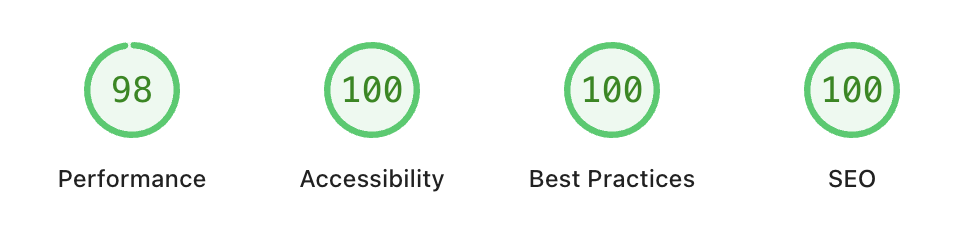
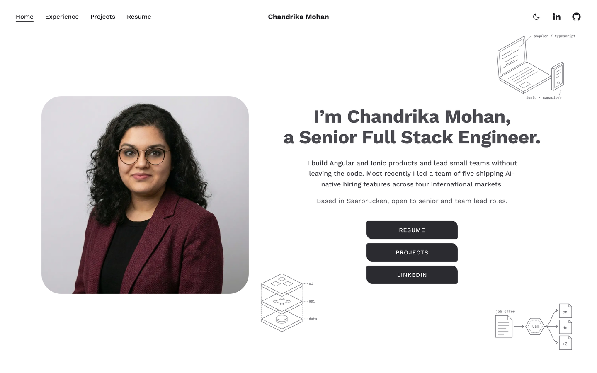
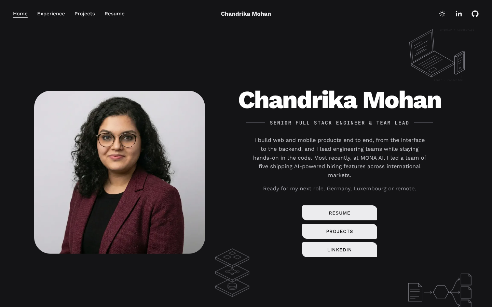
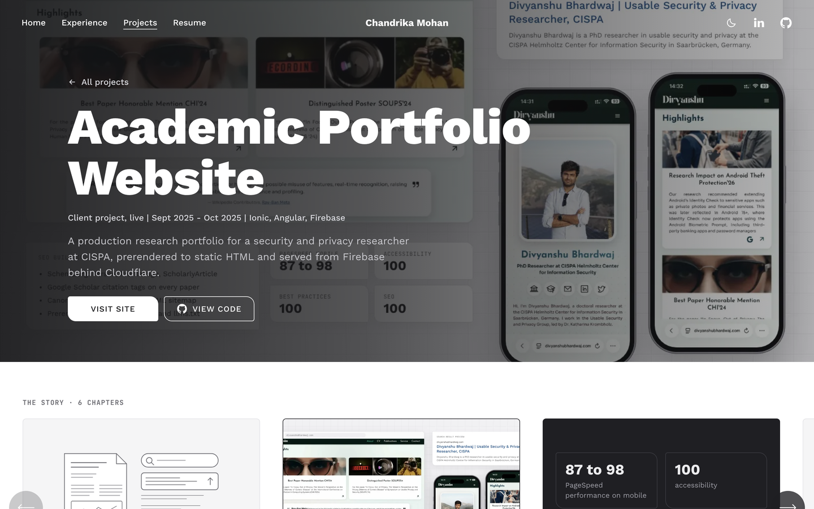
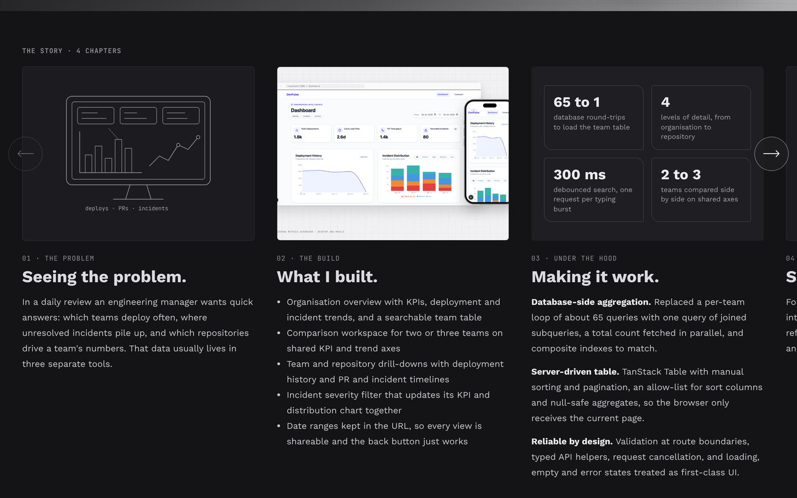
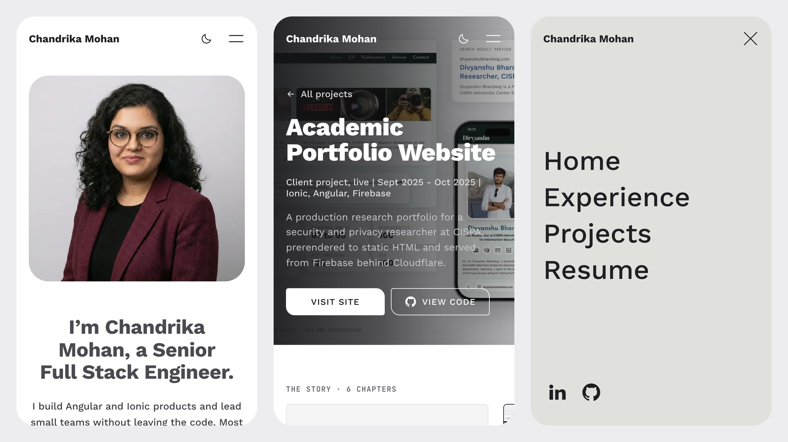

# Chandrika Mohan | Portfolio 🚀

A high-performance, modern professional portfolio built for **myself (Chandrika Mohan)**, a Senior Fullstack Engineer & Team Lead. This site showcases technical expertise in AI-driven automation, scalable architectures, and modern web development.

## 🔗 Live URL     [chandrikamohan.com](https://chandrikamohan.com)

## ✨ Key Features

- **Modern Responsive Design**: Built with **React 19** and **Tailwind CSS** for a fluid, accessible experience across all devices.
- **Dark Mode Support**: Seamless transition between Light and Dark themes with system preference detection.
- **Performance Optimized**: Achieves high scores in Core Web Vitals through Vite's lightning-fast build system and aggressive asset caching.
- **SEO Ready**: Dynamic `sitemap.xml` and `robots.txt` generation for optimal search engine crawling.
- **Glassmorphism UI**: High-end aesthetic using backdrop filters and custom indigo-based design tokens.

## 🛠 Tech Stack

- **Frontend**: React 19, TypeScript, Vite
- **Styling**: Tailwind CSS, Lucide React (Icons)
- **Backend/Infrastructure**: Firebase Hosting, Firebase Analytics
- **Tools**: PostCSS, Autoprefixer, ESLint
- **SEO**: Google Search Console, Bing Web Masters

## 🚀 Getting Started

### Prerequisites
- Node.js (v18+)
- npm or yarn
- Firebase CLI (`npm install -g firebase-tools`)

### Installation
1. Clone the repository:
   ```bash
   git clone https://github.com/chandrikamohan/portfolio.git
   cd portfolio
   ```

2. Install dependencies:
   ```bash
   npm install
   ```
   
### Development
Run the local development server:
```bash
npm run dev
```

### Build & Deployment
Build the project for production:
```bash
npm run build
```

Deploy to Firebase:
```bash
firebase deploy
```

## 📁 Project Structure

- `src/` (Conceptual root):
  - `App.tsx`: Main application logic and AI integration.
  - `data.ts`: Centralized configuration for CV data and personal info.
  - `types.ts`: TypeScript interfaces for data consistency.
  - `firebase.ts`: Firebase SDK initialization.
- `public/`: Static assets, sitemap, and robots.txt.
- `index.html`: Entry point with Tailwind configuration and import maps.

## 📸 Screenshots

### ✨ Google PageSpeed Insights


### Light Mode & Hero Section
*A clean, white Blueprint design with hand-drawn line art.*



### Dark Mode
*The same layout in a soft dark palette, following the system setting or the switch in the header.*



### Project case study
*Each project opens a page with a full-width hero and the story told in sideways chapters.*




### On mobile



## 📄 License
This project is for personal portfolio use. Content and design © 2025 Chandrika Mohan.
