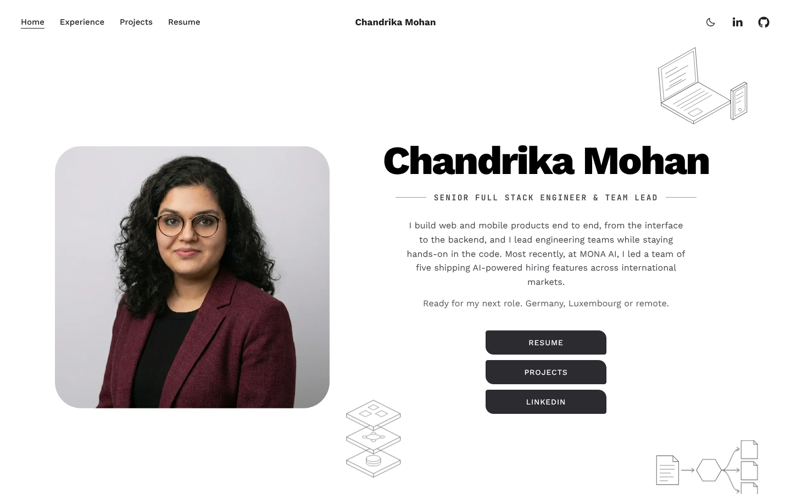
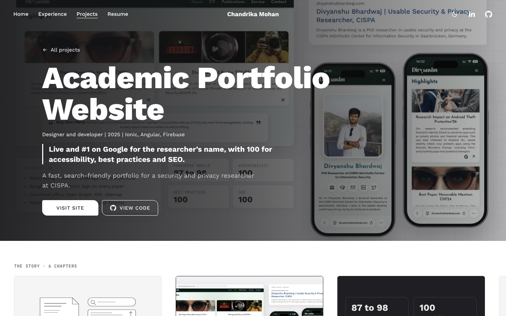
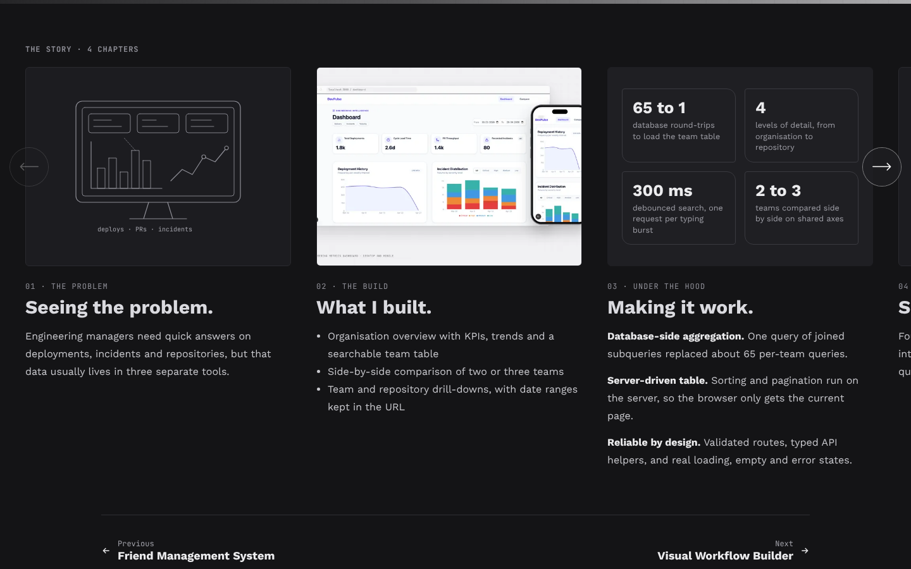
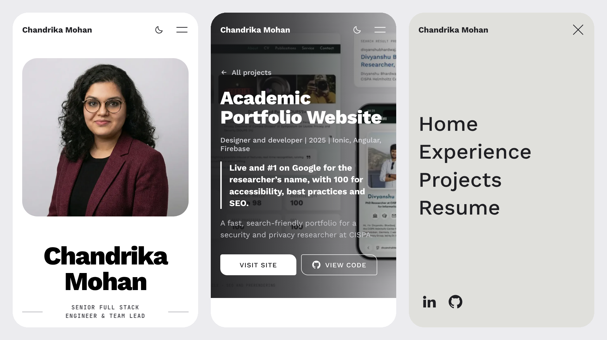

# Chandrika Mohan | Portfolio 🚀

The source of my personal portfolio at [chandrikamohan.com](https://chandrikamohan.com). I'm a Senior Full Stack Engineer and Engineering Team Lead based in Saarbrücken, Germany. The site covers my experience, skills, education and case studies of selected projects.

## 🔗 Live URL     [chandrikamohan.com](https://chandrikamohan.com)

## ✨ Key Features

- **Blueprint design**: A clean white layout with hand-drawn style line-art drawings that sketch themselves in on load. All motion is off for visitors who prefer reduced motion.
- **Project case studies**: Every project has its own page at `/projects/<slug>/` with the problem, what was built, technical highlights and results.
- **Dark mode**: Follows the system setting by default, with a light/dark switch in the header.
- **Fast**: Every page is prerendered to static HTML at build time, fonts (Work Sans, JetBrains Mono) are self-hosted, and pages are served from the Firebase CDN behind Cloudflare.
- **SEO and AI search ready**: Per-page titles, descriptions, canonical URLs and link previews, structured data on the home page, and a `sitemap.xml`, `robots.txt` and `llms.txt` generated at build time.
- **Privacy by design**: No analytics, no tracking cookies, no third-party requests.

## 🛠 Tech Stack

- **Frontend**: React 19, TypeScript, Vite
- **Styling**: Hand-written CSS, inline SVG drawings and icons
- **Prerendering**: React static rendering at build time (`prerender.mjs`)
- **Hosting**: Firebase Hosting behind Cloudflare
- **SEO**: Google Search Console, Bing Webmaster Tools

## 🚀 Build & Deployment

The source code is kept in a private repository. For reference, the site is built and deployed with:

```bash
npm ci
npm run build    # type check, bundle, prerender every page, write sitemap.xml and llms.txt
npx firebase-tools deploy --only hosting
```

Requires Node.js 20 or newer.

## 📁 Project Structure

- `index.html`: Page template with meta tags and structured data.
- `index.tsx`, `App.tsx`: App entry and routing.
- `entry-server.tsx`, `prerender.mjs`: Build-time prerendering, sitemap and `llms.txt`.
- `components/`: Layout, home page, project pages, carousel and line-art drawings.
- `content/data.ts`: All site content (experience, projects, skills, education).
- `types.ts`: TypeScript types for the content.
- `index.css`: Styles and design tokens for light and dark mode.
- `assets/`: Static files (fonts, images, link preview images, CV, `robots.txt`).
- `datenschutz.html`, `404.html`: Privacy policy and error page.
- `firebase.json`: Hosting config, redirects and cache headers.

## 📈 Google Search Console

Overview for the last 3 months (10 Aug to 9 Nov 2026):

| Clicks | Impressions | Average CTR | Average position |
|---:|---:|---:|---:|
| 12 | 246 | 4.9% | 9.5 |

- Searches for my name rank at an average position of **2.8**.
- 5 pages are indexed on Google.
- Most clicks come from Germany, with impressions from over 20 countries.

## 📸 Screenshots

### ✨ Google PageSpeed Insights


### Light Mode & Hero Section
*A clean, white Blueprint design with hand-drawn line art.*



### Dark Mode
*The same layout in a soft dark palette, following the system setting or the switch in the header.*


### Project case study
*Each project opens a page with a full-width hero and the story told in sideways chapters.*




### On mobile



## 📄 License
This project is for personal portfolio use. Content and design © 2025-2026 Chandrika Mohan.
